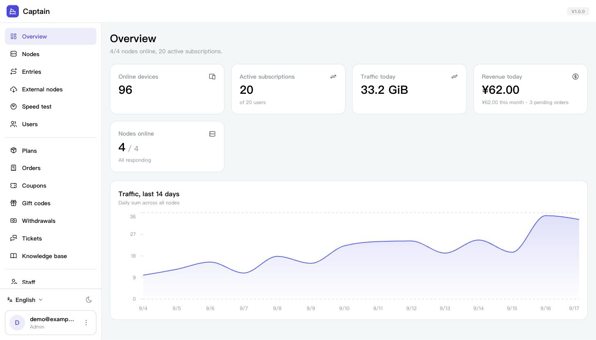
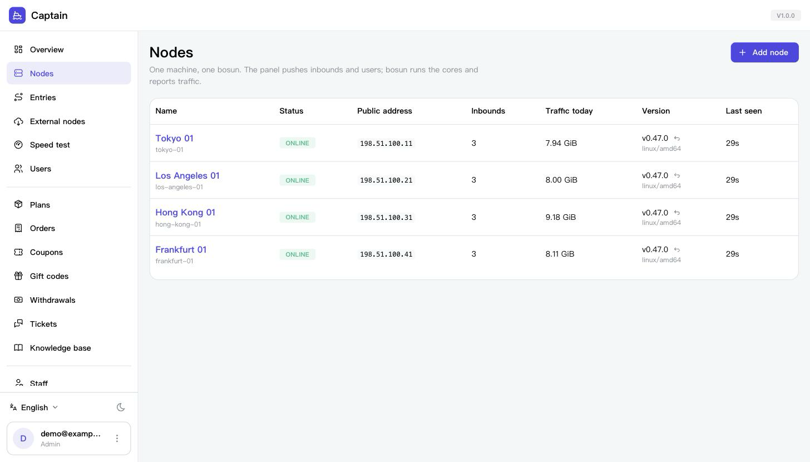
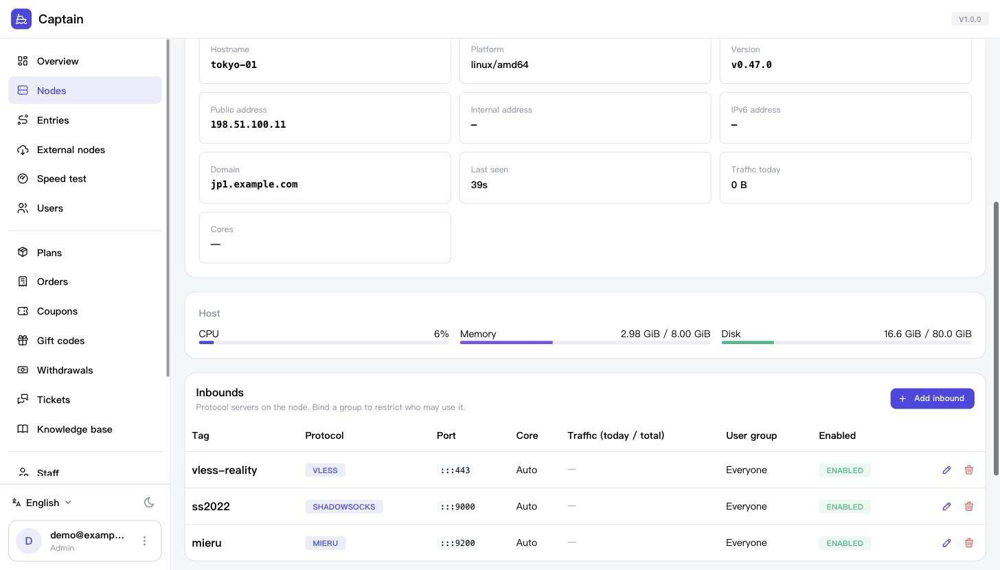
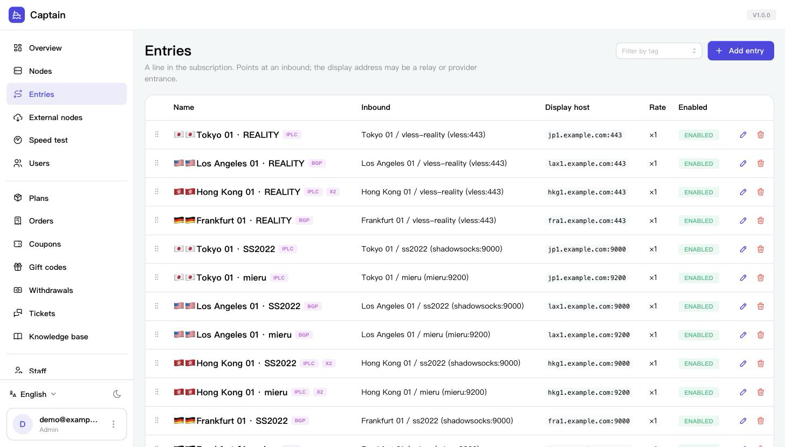
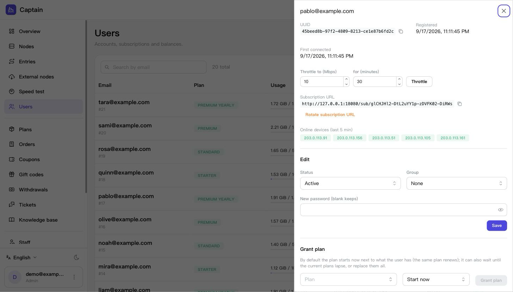
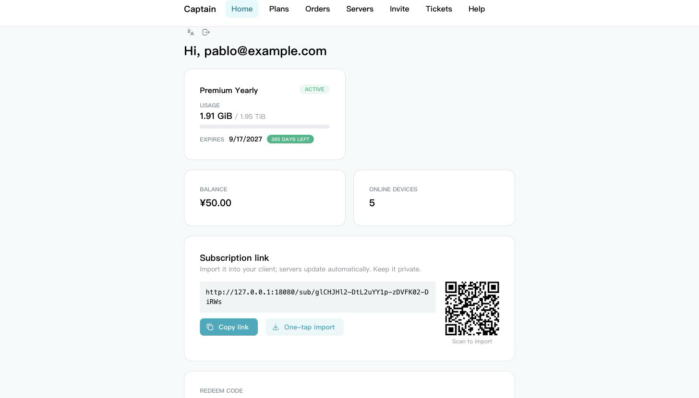

**English** · [简体中文](README.zh-CN.md)

<div align="center">

# Captain

**A proxy panel that actually runs the fleet: users, plans, payments, subscriptions — and the nodes themselves.**

[](https://github.com/zeptop-dev/captain/releases)
[](https://github.com/zeptop-dev/captain/actions)
[](go.mod)
[](https://github.com/zeptop-dev/captain/releases)
[](https://hub.docker.com/r/zeptop/captain)
[](LICENSE)

[Install](#quick-start) · [Documentation](#documentation) · [Compatibility](docs/COMPATIBILITY.md) · [Changelog](CHANGELOG.md)

</div>

---

Captain v1.22 / bosun v0.70 add one-click managed NextTrace installation, runtime tool/ICMP checks and upgrade dialogs showing actual stages.

Node management now provides shared status-page groups and ordering: drag or use arrow buttons, move nodes in batches, and save with concurrent-edit protection. No bosun update is required. The node country selector also supports automatic IP detection, manual flag/code selection, or hiding the region. [Groups and order](docs/NODES.md#groups-and-display-order).

Captain v1.21 / bosun v0.69 add private three-carrier return-route diagnostics and independently observed public IPv4/IPv6, with optional address following that preserves fixed public entries. [Node monitoring and addresses](docs/NODES.md).

Captain v1.20 / bosun v0.68 add managed reverse WireGuard: B initiates the tunnel, A authenticates and bills users, and explicit private-network grants use B-side SNAT. User speed limits are shared across ordinary egress and WG links on A. [WireGuard](docs/NODES.md#managed-reverse-wireguard-captain-120--bosun-068).

**Captain v1.28 / bosun v0.75 WG improvements:** new connections default to IPv4 preference for
dual-stack domains and explicit automatic UFW forwarding on B. Existing links
keep their routing and manual rules until edited. Fresh node capabilities gate
both options; unsupported firewalls/routing and disabled global auto-open report
failure. Rule synchronization and tunnel handshakes do not prove client access.
[Forwarding support and address-family limits](docs/NODES.md#automatic-forwarding-on-b).

Captain v1.28 / bosun v0.75 also add WG dependency checks and explicit package installation, faster initial IP/DNS synchronization, and supported core-only private grants that preserve WARP/proxy split routing.

Captain is one Go binary with the admin console and the user portal embedded.
It sells access (plans, orders, eight payment gateways, invites, coupons,
tickets), renders subscriptions for every client people actually use, and
drives the nodes: you paste one command on a fresh server and the node
appears in the console, configured, with certificates.

The node side is [**bosun**](https://github.com/zeptop-dev/bosun), a root
agent that runs sing-box, Xray, mita (mieru), Hysteria, snell-server and
realm as child processes from the desired state Captain pushes. The two
speak a documented, add-only protocol, so a node never has to be upgraded
in lockstep with the panel.

> [!IMPORTANT]
> This is infrastructure for running your own service for yourself, your
> friends or your customers. You are responsible for what runs through it
> and for the law where your servers and your users are. Check both before
> you deploy.

Monitor-only nodes can be installed without proxy cores and later switched to full nodes. Monitoring, alerts and agent updates remain available; proxy configuration is blocked on both panel and agent. See [node modes](docs/NODES.md#monitor-only-nodes-captain-118--bosun-066).

## Features

- The customer portal puts individual plan quotas and expiry beside quick connection actions, with dedicated Connect, billing, help and account sections and mobile bottom navigation. Login, registration and password reset share the site's branding, theme and language controls. Downloads, supported imports, QR codes and searchable nodes share one setup flow; payment returns use actual order status. [Customer portal](docs/BILLING.md#the-portal).
- Glass financial summaries use one configurable currency with daily server-side exchange-rate caching, while server details retain original prices. Missing quotes and old cached rates stay explicit; server metadata is never sent to the rate provider. [Cost estimates](docs/MONITORING.md#probe-and-status-page).
- Administrator subscription presets combine Basic, synchronized official ACL4SSR configurations and saved custom designs. Regional selectors offer automatic latency selection and individual nodes, prioritize registered entry regions, and omit unused empty regions. Regional groups, Claude routing and WebRTC/QUIC restrictions use native adapters for all seven designer formats; DNS and individual rule/group features report client-specific limits. Cached upstream notes identify the source revision before loading. Claude updates use pinned community snapshots, a difference review and per-format publication versions; syncing either library never changes drafts or published templates. [Preset workflow and limits](docs/SUBSCRIPTIONS.md#templates-and-the-designer).
- Server lists and details separate network-interface traffic for the saved reset cycle from today's user proxy traffic (UTC). Managed reverse WireGuard / VLESS Reverse traffic is measured on front server A and displayed against exit B, with collection details and incomplete-history indicators; customer billing still happens once. bosun v0.76.1 avoids counting managed WireGuard and shaping interfaces twice in automatic host totals. [Traffic definitions](docs/MONITORING.md#probe-and-status-page).
- Register an independent WireGuard identity for each device in the portal or user details, then copy its WG-only subscription or download a single-node configuration. Devices share their parent's usage and limits; revoking one does not revoke the others. Use bosun v0.77.1 or later and explicit activation of the supported Xray `26.7.28-r3` package; the default core version is not changed automatically. [Device subscriptions and limits](docs/SUBSCRIPTIONS.md#independent-wireguard-devices).
- Status cards show CPU specifications and selectable filesystem capacity, with advertised bandwidth below remaining days on Glass cards and inside network information in details. Enter monthly traffic limits directly in MB, GB or TB; use automatic storage recommendations or choose, name and order public volumes without exposing mount paths. Captain v1.34 adds an independent capacity history chart for each selected volume. Full CPU topology and mergerfs collection require bosun ≥ v0.76.0; older nodes remain compatible. [Status-page monitoring](docs/MONITORING.md).
- Reuse each server's registered internal IP for explicitly selected forwarding hops and landing inbounds. Preview actual targets, check TCP from the preceding server, and refresh referenced paths when addresses change. Existing paths and published subscription endpoints retain their defaults. [Internal forwarding addresses](docs/NODES.md#reusing-a-servers-internal-address).
- Manage subscription nodes and reusable server lines together: create a direct node, publish a relay/nft/realm path, or connect two subscription nodes as a supported client chain. Server details show the associated configuration and reported state. Lines support TCP failover and weighted candidate selection, with explicit transport and firewall limits. [Lines](docs/NODES.md#managed-server-lines) · [Client chains](docs/SUBSCRIPTIONS.md#managed-server-lines-and-client-chains).
- Organize subscription nodes into display categories, assign them individually or in batches, and filter them in administration and the customer portal. Category names, descriptions and order are independent of permissions, billing, tags and subscription order. [Categories](docs/SUBSCRIPTIONS.md#entries-what-each-user-sees).
- Node domain conflict checks and explicit shared/external DNS management prevent accidental record overwrites. DNS health checks, sustained alerts and durable automatic-write history help diagnose failures and recover recorded previous values. [DNS operations](docs/MONITORING.md).
- Download reviewed core packages and activate a version from node details (bosun ≥ 0.64). Official and Extended sing-box can coexist; SSH TCP proxy subscriptions use persistent host-key pins. [Core management and limitations](docs/NODES.md#managing-node-core-packages).
- Captain v1.27 / bosun v0.74 separate private-policy capabilities from nft runtime status, show prerequisite checks, and automatically select supported enforcement with explicit acknowledgement for core-only access. [Automatic protection](docs/NODES.md#automatic-protection-mode).
- Administrators can grant private destinations per inbound, with explicit CIDR/protocol/port scopes and default isolation elsewhere. Managed Reverse policies are enforced separately at the exit; requires bosun ≥ 0.63 and a supported Linux nft sing-box/Xray configuration. [Usage and boundaries](docs/NODES.md#per-inbound-private-access-captain-114--bosun-063).
- Node routing includes administrator-only, port/protocol-scoped private upstream exceptions (bosun ≥ 0.62). Forwarding distinguishes TCP probe health from untested UDP, and nft supports same-family IPv6 targets.
- Direct common-page navigation with secondary tools under More; a dashboard that puts node issues and daily tasks first and links to filtered lists. Searchable settings categories, independent editors, protected drafts, responsive forms, and direct user-to-subscription and node-to-entry workflows. [Console navigation](docs/ADMIN.md#finding-a-task).
- Fleet administration: scoped automation tokens, staff Passkeys, subscription-aware user filters and previewed bulk operations, private metadata, named subscription profiles/templates, typed configuration presets, and a supplier/asset renewal ledger. [Workflows and boundaries](docs/ADMIN_WORKFLOWS.md).
- Reliable traffic delivery pairs atomic receipts/accounting with bosun's durable frozen batches; node exit diagnostics add structured IPv4/IPv6, ASN/region and optional service observations (bosun >= 0.57.0).

Node deletion can retain bosun in standalone mode, uninstall it with optional
data retention, or only remove the panel record. Remote actions need bosun
≥ v0.55.0; see [node removal](docs/NODES.md#removing-a-node).

**Protocols and cores** ([docs](docs/NODES.md#inbounds)) — VLESS (+ REALITY, with a decoy site and a target
scanner), VMess, Trojan, Shadowsocks (incl. 2022 ciphers and ShadowTLS v3),
Hysteria2, TUIC, AnyTLS, mieru, Snell, SOCKS, HTTP, SSH TCP proxy, NaiveProxy and
WireGuard. Each inbound
picks its core; bosun installs and supervises the reviewed binaries as
separate processes, including the optional sing-box Extended distribution.
Inbound core choices follow protocol and feature compatibility, with automatic previews, node availability and a separate running-core indicator.

**Subscriptions that fit the client** ([docs](docs/SUBSCRIPTIONS.md)) — mihomo/Clash, Stash, sing-box,
Egern, Surge, Surfboard, Loon, Quantumult X, base64 share links (v2rayN,
Shadowrocket) and WireGuard `.conf`, each following that client's own
reference so a server it cannot express is simply left out. Per-format
templates, a visual proxy-group and rule designer with the ACL4SSR
catalogue, remark variables (`{{DAYS_LEFT}}`, `{{TRAFFIC_LEFT}}`, …), info
lines, short links and revocable temporary links.

**Billing** ([docs](docs/BILLING.md)) — plans with periods, quotas, device and speed limits; several
plans per user (stacked, queued, replace); orders paid by balance, EPay
易支付 (v1 MD5 and v2 RSA), Stripe, Alipay F2F, Coinbase Commerce,
CoinPayments, BTCPay Server or MGate. Every callback is signature-verified
before a field is read, settlement is idempotent, and a callback whose
amount differs from the order is refused. Coupons, gift codes, invite
commissions with withdrawals, surplus credit on upgrades.

**The fleet** ([docs](docs/NODES.md)) — one-line node install and pairing; inbounds with quick-setup
recipes; entries that decide what each group of users sees; port forwards
(built-in relay, nftables DNAT or realm) for relay chains with PROXY
protocol across hops and backup or weighted extra targets; NAT / IPLC ingresses with shared inbound/forward port restrictions and range or individual mappings; egress that follows ingress;
multi-transit VLESS Reverse connections with authentication, accounting and target scans at each transit;
REALITY TLS record size screening with bosun v0.61.0 (older nodes show not checked);
per-node speed limits; node jobs (upgrade, rollback, REALITY scan,
speedtest) driven from the console.

**Hardening that is checked, not claimed** ([docs](docs/ADMIN.md#access-control-and-the-client-address)) — cores run under an
unprivileged account with only the capabilities they need; the node's own
address space (loopback, link-local, cloud metadata, RFC 1918) is refused
both in the cores' routing and by an nftables egress guard; the cores'
unauthenticated control APIs are reachable only by root. Origin checks on
cookie writes, argon2id passwords, TOTP for staff, API tokens with a
read-only scope and an expiry, an admin allow-list that also covers the MCP
endpoint, and a per-node doctor that reports what is actually wrong.

**Operations** ([docs](docs/MONITORING.md)) — probe page with per-node history and alerts, Prometheus
metrics, connection log and panel-wide audit rules with auto-ban, dynamic
speed limits computed across nodes, HWID device identification, response
rules on `/sub`, daily `VACUUM INTO` backups uploaded to WebDAV/S3 encrypted
with age and carrying the config file, a panel self-check on the dashboard, self-update for the panel and every node, Telegram bot and event webhooks,
and an MCP server so an agent can answer "which node is down" for you.

Resource monitoring adds per-NIC selection, filesystem/inode and disk I/O detail, logical CPUs and managed-process usage in node details, with a separate public-page switch (bosun ≥ 0.56). Network quality adds failure reasons, P50/P95, jitter and DNS/connect/TLS/response timing, with history counted by actual attempts. The monitoring workspace adds grouping, filtering, four-node comparison and per-device average/peak history; the six-language public page has configurable sections and compact layout. Persistent incidents, acknowledgement/recovery, maintenance/silence windows and contact availability with coverage complete the alert workspace. Node details also provide on-demand DNS, service, download and MTR/traceroute diagnostics with bounded execution and recent results. Optional NVIDIA/AMD GPU readings have private, deduplicated history; the public page offers Aurora/Paper/Terminal/Glassmorphism presets and light/dark/system modes. Glassmorphism embeds the original Komari public UI, including cards/list, latency and loss bars, detail charts and an optional local globe. External Komari/DStatus exporters are retired; the built-in monitoring and theme remain available. See [monitoring](docs/MONITORING.md#resource-detail-captain-17--bosun-056).


**Six languages** in both interfaces — 简体中文, 繁體中文, English, 日本語,
Русский, 한국어 — and the mail users receive has its own language picker in
Settings → Mail.

## Screenshots

<details open>
<summary>Console and portal</summary>

| | |
|---|---|
| **Overview** — fleet, traffic, revenue | **Nodes** — one machine, one bosun |
|  |  |
| **A node** — host metrics, cores, inbounds | **Entries** — what users see, with tags and regions |
|  |  |
| **A user** — plans, devices, throttle, subscription | **Portal** — what the customer gets |
|  |  |

</details>

## Quick start

```sh
curl -fsSL https://raw.githubusercontent.com/zeptop-dev/captain/master/install.sh | sh
```

Console accounts and customers are stored separately in the same database,
with independent IDs; the first customer on a new installation is user 1.
An administrator manages the console; create a separate customer account to
purchase a plan or use a subscription. See [account migration details](docs/ADMIN.md#staff-roles).
Administrators can change customer and staff IDs from their detail/edit views,
keeping subscriptions, credentials and account history intact.
Settings → Reset site clears business data and console settings, retaining the
current administrator's login and deployment files. See [reset scope and node
cleanup](docs/ADMIN.md#reset-site) before using it.

Control public signup in Users → More → Registration and trials → Registration limits.
The registration master switch takes effect immediately and also blocks OIDC
automatic account creation when off; existing users can still sign in.

The installer asks for the panel domain and an admin account, picks Docker
when Docker is present and a systemd service otherwise, obtains a
certificate, and prints the console URL with the credentials. Piped through
`sh` it never writes itself to disk.

Non-interactive, every answer as a flag:

```sh
curl -fsSL https://raw.githubusercontent.com/zeptop-dev/captain/master/install.sh | sh -s -- \
  --mode docker --domain panel.example.com --email you@example.com \
  --admin-email you@example.com --admin-password 'a-long-secret'
```

Then sign in at `https://panel.example.com/admin/`, add a node, and paste
the command the node page gives you on a fresh server:

```sh
curl -fsSL https://panel.example.com/api/agent/install.sh?pair=CODE | sh
```

That installs bosun, pairs it with the panel and applies the configuration.
Users get the portal at `/portal/` and their subscription URL there.

Docker deployments support optional web upgrades through a separate host updater.
Use installer `upgrade` to preserve existing settings and `--web-upgrade` on a new
Docker install to enable the button. See [upgrade and removal](docs/LIFECYCLE.md).

Removing everything the installer set up:

```sh
curl -fsSL https://raw.githubusercontent.com/zeptop-dev/captain/master/install.sh | sh -s -- uninstall --yes
```

Docker Compose, a bare-metal layout, HTTPS choices and Cloudflare Tunnel
are in [docs/DEPLOY.md](docs/DEPLOY.md).

## Supported platforms

|  | Panel (Captain) | Node (bosun) |
|---|---|---|
| Linux amd64 / arm64 | ✅ systemd, OpenRC or Docker | ✅ systemd, OpenRC (Alpine) or Docker |
| Other Unix | builds, unsupported | needs Linux: nftables, tc and capabilities |
| Behind a reverse proxy | ✅ Caddy, nginx, 1Panel, cloudflared | — |

The panel needs no public ports of its own if you publish it through
Cloudflare Tunnel ([docs/CLOUDFLARE_TUNNEL.md](docs/CLOUDFLARE_TUNNEL.md)).

## Database

SQLite, and only SQLite — no Postgres, no MySQL, no Redis. That is a
measured decision, not a shortcut: a repeatable benchmark in the repo
(`internal/store/scale_test.go`) puts a node report that charges 1 000
users at 85 ms, which is a 7 % duty cycle on the single connection at
50 000 users across 50 nodes. Every table that grows with traffic has a cap.
The numbers, the ceilings and what would change the answer are in
[docs/COMPATIBILITY.md](docs/COMPATIBILITY.md#database-sqlite-only-and-what-that-is-good-for).

Backups are a daily `VACUUM INTO` snapshot you can copy, gzip and restore;
restore, upgrade and rollback procedures are in
[docs/OPERATIONS.md](docs/OPERATIONS.md).

## Configuration

`/etc/captain/config.yaml` (full example: [config.example.yaml](config.example.yaml)).
Unknown keys are refused at start, so a typo never becomes a silent default.

| Key | What it does | Default |
|---|---|---|
| `base_url` | the panel's public origin; used for links, origin checks and ACME | — |
| `listen` | address to serve on | `:8080` |
| `tls.auto`, `tls.email` | obtain the panel's own certificate | off |
| `database.dsn` | SQLite file | `/var/lib/captain/captain.db` |
| `agent.pull_seconds`, `agent.push_seconds` | how often a node fetches state and reports | 60 / 60 |
| `trusted_proxies` | proxies whose forwarding headers are believed | loopback + private |
| `admin_allow_cidrs` *(setting)* | addresses allowed to reach the console and `/mcp` | open |
| `min_version` | floor for self-update and rollback | unset |
| `payments.*` | gateway credentials | none enabled |

## Documentation

| | |
|---|---|
| [DEPLOY.md](docs/DEPLOY.md) | installer, Docker, bare metal, HTTPS, subscription hosts |
| [BILLING.md](docs/BILLING.md) | plans, payment gateways, coupons, gift codes, invites, registration limits |
| [SUBSCRIPTIONS.md](docs/SUBSCRIPTIONS.md) | formats and templates, entries, remark variables, response rules, HWID, short links |
| [NODES.md](docs/NODES.md) | nodes and inbounds, relays and forwards, line ingresses, egress, certificates |
| [MONITORING.md](docs/MONITORING.md) | probe and status page, alerts, metrics, connection log, audit rules, dynamic limits |
| [ADMIN.md](docs/ADMIN.md) | staff roles, API tokens, access control, webhooks, Telegram, mail, OIDC, backups |
| [OPERATIONS.md](docs/OPERATIONS.md) | backups, restore, upgrade, rollback, what to monitor, client addresses |
| [COMPATIBILITY.md](docs/COMPATIBILITY.md) | what a release promises, the bosun version matrix, the database ceiling |
| [ARCHITECTURE.md](docs/ARCHITECTURE.md) | packages, domain model, agent protocol, jobs |
| [CLOUDFLARE_TUNNEL.md](docs/CLOUDFLARE_TUNNEL.md) | no public IP, no open ports |
| [MCP.md](docs/MCP.md) | the Model Context Protocol server and its tools |
| [bosun](https://github.com/zeptop-dev/bosun) | the node agent: cores, forwards, certificates, isolation |

## Versioning

Semantic versioning from 1.0.0. The agent protocol only ever gains fields,
so a node older than the panel keeps working; subscription URLs, the admin
API, webhook payloads and config keys are stable within 1.x; migrations run
forward only. The details, and the Captain ↔ bosun matrix, are in
[docs/COMPATIBILITY.md](docs/COMPATIBILITY.md).

Every release runs the same gates as CI (i18n parity, oxlint, gofmt, vet,
`go test -race`), and releases that touch the node protocol, subscription
output or the money paths also pass a live regression against real nodes
and a real client (`scripts/e2e/README.md`).

## Building from source

Go 1.26 and pnpm:

```sh
make build            # builds web/admin, web/portal, web/site and web/probe, then the binary with them embedded
cp config.example.yaml /etc/captain/config.yaml       # set base_url
bin/captain admin create -c /etc/captain/config.yaml -email you@example.com -password '...'
bin/captain serve -c /etc/captain/config.yaml
```

`make test` runs the Go tests; `internal/http/e2e_test.go` drives the whole
API end to end against a temporary database.

## Contributing

Issues and pull requests are welcome. Please run `make test` and
`python3 scripts/i18n-check.py web/admin/src/i18n web/portal/src/i18n`
before opening one. For anything security-sensitive, open a private
advisory instead of a public issue.

## Acknowledgements

Captain would be pointless without the cores it drives:
[sing-box](https://github.com/SagerNet/sing-box),
[Xray-core](https://github.com/XTLS/Xray-core),
[mieru](https://github.com/enfein/mieru),
[Hysteria](https://github.com/apernet/hysteria),
[snell-server](https://manual.nssurge.com/others/snell.html) and
[realm](https://github.com/zhboner/realm); the clients it renders for,
above all [mihomo](https://github.com/MetaCubeX/mihomo); and
[certmagic](https://github.com/caddyserver/certmagic) for certificates.
The rule catalogue comes from [ACL4SSR](https://github.com/ACL4SSR/ACL4SSR).
Prior art that shaped the feature set: [Xboard](https://github.com/cedar2025/Xboard),
[3x-ui](https://github.com/MHSanaei/3x-ui) and
[Remnawave](https://github.com/remnawave/panel).

## License

MIT — see [LICENSE](LICENSE).

<details>
<summary>Star history</summary>

[](https://star-history.com/#zeptop-dev/captain&Date)

</details>

### Host management

Automatic listener firewall rules show their sources and synchronization state; shared ports stay open until their last reference disappears. Manual and ambiguous legacy rules are retained (bosun v0.72.0+).

Captain node details expose observed host state, individual changes and operation history. Native root Debian/Ubuntu systemd nodes support bounded management jobs with independent local recovery for access/network changes. Other environments are read-only; missing system packages are not installed automatically.

Node probe settings support structured amounts/currencies/payment cycles, calendar expiry dates, and monthly traffic resets linked to the expiry day or following day. Optional online automatic renewal advances expiry after a new resource report, preserving the original calendar day through short months. It maintains the probe record without making hosting payments. Legacy price text and manual reset settings are preserved; see [Monitoring](docs/MONITORING.md#node-cost-and-expiry-linked-traffic-reset).

Node probe settings also record advertised Mbps/Gbps capacity, optionally separated into server RX/TX, with opt-in display in both status-page themes. This is metadata only, not shaping or a speed test; see [Advertised bandwidth](docs/MONITORING.md#advertised-server-bandwidth).

Captain can provide customer login to New API through registered confidential OAuth applications. Configure New API Custom OAuth with `profile email`; see [setup and limits](docs/CAPTAIN_LOGIN.md).
